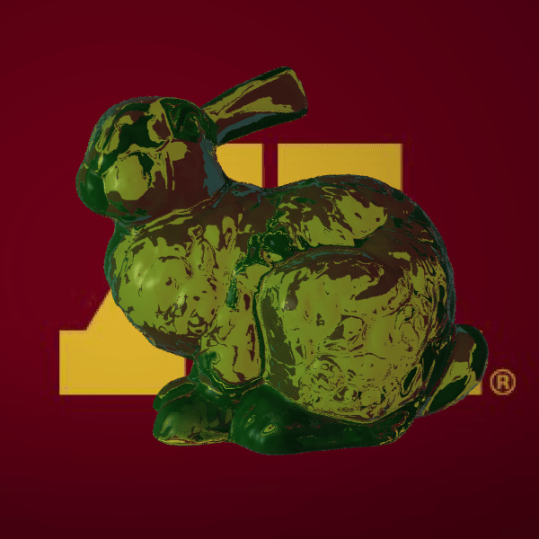

# raytracer

A multithreaded CPU ray tracer written from scratch in modern C++. It renders triangle meshes and spheres with Blinn-Phong shading, Fresnel-weighted reflection and refraction, image textures, and cel shading. Scenes are described in JSON, and a BVH acceleration structure makes it practical to render meshes with more than 100k triangles on a laptop.

<p align="center">
  
  <br>
  <em>The Stanford bunny (144k triangles) as green glass in front of a textured plane. 60 frames at 600×600 with 4 samples per pixel, rendered in under 3 minutes on an Apple Silicon laptop (about 3 s per frame). Made with <a href="#animations"><code>scripts/render_animation.py</code></a>.</em>
</p>

## Highlights

**Rendering**
- Whitted-style recursive ray tracing with a configurable max depth
- Blinn-Phong materials: ambient, diffuse, and specular terms with per-light attenuation (`1 / (c0 + c1·d + c2·d²)`)
- **Shadows** from point and directional lights, traced through the BVH. Partially transparent occluders let `1 - alpha` of the light through, and shadow rays start just off the surface on the light's side, which prevents shadow acne on meshes.
- Reflection and refraction weighted by **Schlick's Fresnel approximation**, with total internal reflection and tracking of whether each ray is entering or leaving a medium
- **Toon / cel shading**: a half-Lambert term indexes a 1D color-ramp texture
- **Wireframe mode**: triangle edges are found from barycentric coordinates, with an adjustable edge threshold
- Image textures from PPM files, with planar UV projection as a fallback for meshes that have no texture coordinates
- Depth cueing, which blends distant surfaces toward a fog color
- Stochastic **supersampling anti-aliasing** (N×N jittered samples per pixel)

**Performance**
- **Bounding volume hierarchy (BVH)**: object-median splits along the longest axis using `std::nth_element`, stored as a flat node array. Traversal is front-to-back and skips any node that is farther than the closest hit found so far.
- Ray/box tests use the slab method (AABB), and ray/triangle tests use **Möller–Trumbore**
- **Multithreaded rendering**: a pool of `std::thread`s pulls rows from an `std::atomic` counter, which balances work dynamically so no thread sits idle behind a hard region of the image
- Uniform-color materials precompute their shading coefficients
- Tuned Release flags for MSVC (`/O2 /GL /arch:AVX2`, LTCG) and Clang (`-O3 -march=native -flto -ffast-math`, with `-fno-finite-math-only` so the infinite distances used during BVH traversal still compare correctly)

**Engineering**
- CMake project split into a reusable static library (`raytracerlib`) and thin executables (`apps/`)
- Dependencies are fetched automatically with CMake `FetchContent`: [nlohmann/json](https://github.com/nlohmann/json) and [Catch2](https://github.com/catchorg/Catch2). OBJ files are loaded with [tinyobjloader](https://github.com/tinyobjloader/tinyobjloader), which is vendored.
- A dedicated math layer where `Point3` and `Vector3` are separate types, so the compiler rejects meaningless operations such as adding two points. It also includes 4×4 matrices and TRS object-to-world transforms.
- Unit tests for the vector/point math, float comparison utilities, AABBs (including transformed primitives), scene parsing, and shadows. The shadow tests cover occluders on, beyond, and beside the light path, transparent occluders, self-shadowing on curved surfaces and meshes, and the final shaded color.
- A Python script that renders turntable animations into a looping GIF with ffmpeg, with previews at any resolution, progress and time estimates, and clear errors

## Building

Requires CMake 3.15 or newer, a C++17 compiler, and an internet connection the first time you configure, so dependencies can be fetched.

```sh
cmake -S . -B build -DCMAKE_BUILD_TYPE=Release
cmake --build build -j
```

This builds:

| Target | Path |
|---|---|
| `raytracer-cli` | `build/apps/raytracer-cli/raytracer-cli` |
| unit tests | `build/bin/*_tests` (run all of them with `ctest --test-dir build`) |

The build symlinks `files/` (scenes, meshes, textures) into the build directory.

## Usage

The example scenes use paths relative to the executable's directory, so run it from there:

```sh
cd build/apps/raytracer-cli
./raytracer-cli ../../files/scenes/glass_bunny.json
```

The image is written to `render.ppm` in the current directory. Preview on macOS opens PPM files directly. To convert one to PNG, run `magick render.ppm render.png`.

| Option | Description |
|---|---|
| `-S, --samples <n>` | Anti-aliasing: an n×n grid of jittered samples per pixel (default `2`; `1` disables it) |
| `-D, --depth <n>` | Maximum recursion depth for reflection and refraction (default `4`) |
| `-W, --wireframe` | Render triangle edges only |
| `-E, --edge-threshold <f>` | Barycentric threshold used to detect edges in wireframe mode (default `0.02`) |
| `-d, --debug` | Render on a single thread, which is easier to step through in a debugger |

### Animations

`scripts/render_animation.py` spins a mesh through a full turn, renders each frame with `raytracer-cli`, and stitches the frames into a looping GIF. It needs Python 3.8+ and [`ffmpeg`](https://ffmpeg.org/) on your `PATH`. It finds the `raytracer-cli` you built under `build/` automatically, and you can run it from any directory:

```sh
# quick low-res preview: 24 frames at 300×300, no anti-aliasing
python3 scripts/render_animation.py files/scenes/glass_bunny.json --size 300 300 --frames 24 -S 1 -o preview.gif

# full quality, at the resolution set in the scene
python3 scripts/render_animation.py files/scenes/glass_bunny.json -o glass_bunny.gif
```

| Option | Description |
|---|---|
| `-o, --output <file>` | Output GIF (default: `<scene name>.gif` in the current directory) |
| `-n, --frames <n>` | Number of frames (default `36`) |
| `--fps <n>` | GIF frame rate (default `10`) |
| `--axis {x,y,z}` | Rotation axis (default `y`) |
| `--degrees <deg>` | Total rotation (default `360`, which loops seamlessly) |
| `--mesh <i>` | Which entry in the scene's `meshes` list to rotate (default `0`) |
| `--size <w> <h>` | Override the camera resolution |
| `-S, --samples <n>` | Anti-aliasing samples, passed through to `raytracer-cli` |
| `--keep-frames <dir>` | Also save the individual PPM frames |
| `--raytracer <path>` | Use a specific `raytracer-cli` binary |

Your scene file is never modified. Each frame is rendered from a temporary copy. Relative asset paths in the scene are resolved from the `raytracer-cli` directory, just as they are when you run it by hand.

## Scene format

A scene is a single JSON file. Colors are RGB floats in `[0, 1]`, and rotations are in degrees. File paths are resolved relative to the working directory.

```json
{
  "camera": {
    "eye": [0, 0, 0], "view": [0, 0, -1], "up": [0, 1, 0],
    "hfov": 60,
    "imsize": [1080, 1080],
    "depthcueing": { "color": [0, 0, 0], "alpha": [0.1, 1], "dist": [1, 50] }
  },
  "bkgcolor": [0.255, 0.31, 0.41],
  "bkgeta": 1.0003,

  "materials": [
    { "name": "green_glass", "type": "blinn-phong",
      "diffuse": [0.076, 0.614, 0.076], "specular": [1, 1, 1],
      "ka": 0.28, "kd": 1, "ks": 0.8, "n": 76.8,
      "alpha": 0.25, "eta": 1.5 },
    { "name": "logo", "type": "blinn-phong", "imagetexture": "../../files/textures/umn.ppm",
      "ka": 0.2, "kd": 0.8, "ks": 0, "n": 20, "alpha": 1, "eta": 1.2 },
    { "name": "toon", "type": "toon", "imagetexture": "../../files/textures/color_ramps/red_ramp3.ppm" }
  ],

  "meshes": [
    { "file": "../../files/objs/stanford/bunny.obj", "material": "green_glass",
      "transform": { "translate": [0, 0, -2], "rotate": [0, 0, 0], "scale": [1, 1, 1] } }
  ],
  "spheres": [
    { "center": [1, 0, -4], "radius": 0.5, "material": "toon" }
  ],

  "lights": [
    { "type": "point", "l": [-3, 0, 0], "i": 1, "att": [1, 0.1, 0.01] },
    { "type": "directional", "l": [0, 0, -1], "i": 1 }
  ]
}
```

| Key | Notes |
|---|---|
| `camera` | Required. `depthcueing` is optional. |
| `bkgeta` | Refractive index of the surrounding medium. Defaults to air (`1.000293`). |
| `materials[].type` | `blinn-phong` (the default) or `toon`. The base color comes from `diffuse`, `colortexture`, or `imagetexture` (an ASCII `P3` PPM file). `alpha < 1` enables refraction, and `ks > 0` enables reflection. |
| `meshes[]` | Any OBJ file. Faces are triangulated on load. If a mesh has no `material`, the per-face `usemtl` names are matched against the scene's materials. |
| `lights[]` | `point` (position, with optional `att` coefficients) or `directional` (direction). |

More examples are in [`files/scenes/`](files/scenes).

## Project structure

```
include/, src/          raytracerlib: the renderer as a static library
  math/                 Vector3, Point3, Point2, Matrix4x4, Transform, Ray, float utilities
  geometry/             Sphere, Triangle, Mesh, Plane, Primitive, AABB, BVH, Hit
  gfx/                  Camera, Scene (JSON loader), Material, Texture, Lights, Raytracer core
apps/raytracer-cli/     command-line renderer (argument parsing, thread pool, PPM output)
tests/                  Catch2 unit tests
scripts/                animation rendering
files/                  example scenes, OBJ meshes (Stanford bunny and dragon, etc.), textures
```

A `Primitive` pairs a shape (`Sphere` or `Triangle`) with a material and a transform. The BVH is built over a flat list of primitives, and `Raytracer::trace_ray` handles the recursion: intersect the scene, then spawn reflection and refraction rays, then pass the results to the material's `evaluate`, which casts a shadow ray toward each light through `Raytracer::shadow_factor`.

## Status and roadmap

This is an ongoing personal project. It started as a graphics course assignment and has been rewritten since then. In progress:

- [ ] Surface area heuristic (SAH) BVH construction
- [ ] Hook the orthographic (parallel) projection into the JSON camera
- [ ] Output to PNG directly

## License

GPL-3.0. See [LICENSE](LICENSE).
